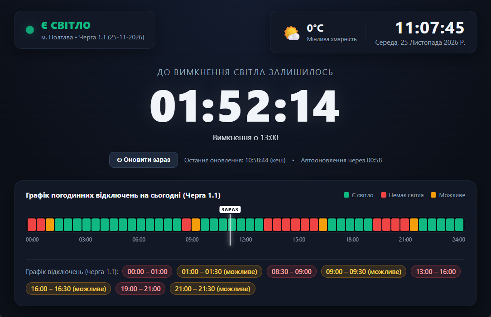

# Personal Power Monitor


 **Проєкт створено з допомогою Gemini.**

Простий монітор графіків погодинних відключень для Полтави, створений для власних потреб і налаштований на чергу **1.1**. Доступні вебінтерфейс і десктопна версія для Windows.



## Можливості

- Показує поточний стан електропостачання та час до наступної зміни за графіком.
- Відображає графік на 24 години з інтервалами по 30 хвилин і підсумком запланованих відключень.
- Автоматично оновлює графік кожні 5 хвилин; є кнопка для ручного оновлення.
- Показує місцевий час і погоду в Полтаві.
- Отримує графік із сайту [Полтаваобленерго](https://www.poe.pl.ua/disconnection/power-outages/); для погоди використовує [Open-Meteo](https://open-meteo.com/).

## Вимоги

- Python 3.9 або новіший.
- Підключення до інтернету для отримання графіка та погоди.
- Windows — для запуску наявних `.bat`-скриптів і десктопної версії.

## Швидкий старт: вебверсія

1. Клонуйте репозиторій і перейдіть до його каталогу:

   ```bat
   git clone https://github.com/liketaurus/Personal-powermon.git
   cd Personal-powermon
   ```

2. Запустіть застосунок:

   ```bat
   start.bat
   ```

   Скрипт встановить залежності з `requirements.txt` і запустить FastAPI через Uvicorn у режимі розробки.

3. Відкрийте [http://127.0.0.1:8000](http://127.0.0.1:8000). Інтерактивна документація API доступна за адресою [http://127.0.0.1:8000/docs](http://127.0.0.1:8000/docs).

Якщо запускаєте вручну, виконайте `pip install -r requirements.txt`, а потім `uvicorn app:app --reload`.

## Десктопна версія для Windows

Спершу встановіть залежності застосунку й інструменти для десктопної версії:

```bat
pip install -r requirements.txt
desktop-install.bat
```

`desktop-install.bat` встановлює PyWebView і PyInstaller. Потім запустіть віконну версію:

```bat
desktop-start.bat
```

Скрипт запускає `desktop.py`: локальний сервер відкривається у вікні PyWebView на адресі `127.0.0.1:8765`.

Щоб зібрати Windows-застосунок, виконайте з кореня репозиторію:

```bat
desktop-exe.bat
```

Зібраний файл `PowerMonitor.exe` має з'явитися у каталозі `dist/`.

## API

- `GET /api/schedule` — графік на сьогодні. Параметр `queue` за замовчуванням має значення `1.1`; `force=true` примусово оновлює дані.
- `GET /health` — перевірка доступності сервера.
- `GET /docs` — інтерактивна документація FastAPI.

## Структура проєкту

- `app.py` — FastAPI-застосунок, отримання та розбір графіка, кешування відповідей.
- `static/index.html` — вебінтерфейс.
- `desktop.py` — запуск локального сервера у вікні PyWebView.
- `start.bat` — встановлення Python-залежностей і запуск вебверсії.
- `desktop-install.bat` — встановлення PyWebView і PyInstaller.
- `desktop-start.bat` — запуск десктопної версії.
- `desktop-exe.bat` — збирання Windows-застосунку за допомогою PyInstaller.

> Дані графіка надходять із зовнішнього сайту та можуть бути недоступні або змінитися. У разі збою застосунок може показати збережені в кеші дані за поточний день; перевіряйте актуальність графіка за офіційними джерелами.